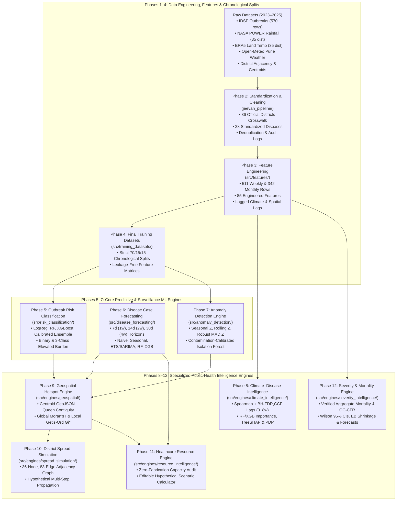

# JEEVAN-DRISHTI — Maharashtra AI-Powered Public-Health Surveillance & Intelligence Platform (`2023–2025`)

**JEEVAN-DRISHTI** is an end-to-end epidemiological data engineering, machine-learning, spatiotemporal analytics, and decision-support platform built for **Maharashtra (`36` official districts)** covering **`2023–2025` IDSP weekly outbreak surveillance** integrated with daily gridded and station climate observations.

---

## 1. Core Scientific & Engineering Principles

1. **Strict `2023–2025` Analytical Scope**:
   - All feature engineering, training splits, ML engines, geospatial hotspot detection, spread simulations, resource scenario calculators, and mortality analyses operate strictly on verified **`2023–2025` Maharashtra IDSP weekly outbreak records** (`570` raw rows deduplicated to **`511` unique `district × disease × week` outbreak observations** across **`34 / 36` active districts**, **`19,172` cases**, and **`199` deaths**).
   - Earlier `2009–2022` `historical_epiclim` records (`1,194` rows) are preserved solely as a separate audit reference and are never mixed into `2023–2025` feature lags, baselines, or case-fatality denominators.
2. **Zero Data Fabrication & Explicit `NaN` Preservation**:
   - Missing or unavailable datasets—such as district population denominators, hospital bed capacities, inpatient admissions, clinical severity grading, relative humidity outside `Pune`, or unrecorded historical deaths—are **never invented or imputed with synthetic constants**. They remain explicitly `NaN` (`Insufficient Data`).
3. **Chronological Validation & Zero Data Leakage**:
   - All supervised ML and forecasting engines use strict chronological splits (`70%` Training: `2023-W01..2024-W30`, `15%` Validation: `2024-W31..2024-W44`, `15%` Untouched Test: `2024-W45..2025-W52`).
   - Contemporaneous weather ($t$) and short-horizon lags unavailable at the forecast origin are excluded to prevent target and future leakage.
4. **Clear Epistemic Separation**:
   - Every dataset, API service, and chart explicitly distinguishes **Observed Surveillance Counts**, **Model Forecasts**, **Statistical Anomalies**, **Correlational Climate Associations**, and **Hypothetical What-If Scenarios**.

---

## 2. System Architecture (`Phases 1–12`)



---

## 3. Summary of Completed Phases (`Phases 1–15`)

| Phase | Engine / Module | Key Methodologies & Safeguards | Primary Code Package | Key Outputs & Reports |
| :---: | :--- | :--- | :--- | :--- |
| **Phase 1** | **Workspace Data Inventory & Audit** | Full audit of 9 raw CSVs (`72,621` rows), schema inspection, date-range verification, and scope restriction to `2023–2025`. | `data/reports/` | `data/reports/dataset_inventory.csv`, `data/reports/data_quality_audit.md` |
| **Phase 2** | **Data Cleaning & Standardization Pipeline** | Standardized all `36` official Maharashtra districts (handling historical aliases like `Aurangabad -> Chhatrapati Sambhajinagar`, `Osmanabad -> Dharashiv`), `28` diseases, ordinal date parsing, and duplicate resolution without silent drops. | `jeevan_pipeline/` | `data/processed/cleaned_disease_data.csv`, `data/processed/cleaned_climate_data.csv`, `data/processed/rejected_records.csv` |
| **Phase 3** | **Epidemiological & Climate Feature Engineering** | Engineered `85` weekly features (`511` rows) and `342` monthly rows (`2023–2025`): disease lags (`1, 2, 3, 4, 8` wks), rolling stats, growth velocity, rainfall/temp/Gadchiroli-override climate lags, spatial neighbor lags, and cyclical encodings. | `src/features/` | `data/features/disease_climate_weekly_features.csv`, `data/features/feature_dictionary.csv`, `reports/feature_engineering_summary.md` |
| **Phase 4** | **Final Modelling Dataset Generation** | Created leak-free datasets for Risk Classification, Case Forecasting (`7d`, `14d`, `30d`), and Anomaly Detection using chronological `70% / 15% / 15%` splits (`Train: 356`, `Val: 79`, `Test: 76` rows) with training-only outbreak thresholds. | `src/training_datasets/` | `data/final_training/risk_classification_dataset.csv`, `forecasting_dataset.csv`, `anomaly_detection_dataset.csv`, `reports/training_dataset_summary.md` |
| **Phase 5** | **Outbreak Risk Classification Engine** | Trained Logistic Regression baseline, Random Forest, XGBoost, and Sigmoid-Calibrated Soft-Voting Ensemble on training-only preprocessing (`PR-AUC = 0.5625` on test vs `0.4835` baseline; `0.347` optimal threshold). | `src/risk_classification/` | `models/risk_classification/best_risk_model.pkl`, `reports/risk_model_performance.csv`, `reports/risk_model_evaluation.md` |
| **Phase 6** | **Time-Series Disease Forecasting Engine** | Multi-horizon weekly case forecasting for `7d` (`1w`), `14d` (`2w`), and `30d` (`4w`) comparing Last-Value, Seasonal Naive, ETS/SARIMA, Random Forest, and Huber-loss XGBoost with strict horizon lag cutoffs and rolling-origin backtesting. | `src/disease_forecasting/` | `models/disease_forecasting/forecasting_model.pkl`, `reports/forecasting_performance.csv`, `reports/actual_vs_predicted.csv` |
| **Phase 7** | **Disease Anomaly Detection Engine** | Implemented Seasonal Baseline Deviation, Rolling Statistical Z-score, Robust MAD Z-score, and Contamination-Calibrated Isolation Forest + Consensus Ensemble across `511` outbreak weeks (`116` consensus signals across 4 categories). | `src/anomaly_detection/` | `models/anomaly_detection/isolation_forest_pipeline.pkl`, `reports/anomaly_detection_results.csv`, `reports/anomaly_performance_report.md` |
| **Phase 8** | **Climate–Disease Intelligence Engine** | Analyzed Pearson/Spearman correlations with Benjamini-Hochberg FDR (`q < 0.05`), lagged cross-correlations (`0..8` wks), Seasonal Kruskal-Wallis (`p = 3.21e-05`), and RF/XGBoost + exact TreeSHAP & Partial Dependence curves under a strict non-causal 4-tier framework. | `src/engines/climate_intelligence/` | `data/climate_intelligence/`, `reports/climate_intelligence/climate_disease_intelligence_report.md` + `7` PNG figures |
| **Phase 9** | **Geospatial Disease Hotspot Detection Engine** | Standardized all `36` Maharashtra districts onto verified centroids (`35` exact + `Mumbai Suburban` documented approximation), built `83`-edge Queen contiguity graph, and computed Global Moran's $I$ ($I = 0.2429, p = 0.011$) & Local Getis-Ord $G_i^*$ (`14` hotspots). | `src/engines/geospatial/` | `data/geospatial/maharashtra_district_points.geojson`, `district_hotspot_statistics.csv`, `reports/geospatial/geospatial_hotspot_report.md` + `6` PNG figures |
| **Phase 10** | **District Spread Propagation & Scenario Engine** | Built a `36`-node, `83`-edge (`166` directed arcs) district graph and deterministic multi-step (`T = 1..26` wks) hypothetical spread simulator with `6` benchmark scenarios, `108` sensitivity runs, and an interactive HTML simulator. | `src/engines/spread_simulation/` | `data/scenarios/`, `reports/spread_simulation/interactive_spread_scenario_simulator.html`, `spread_simulation_report.md` + `5` PNG figures |
| **Phase 11** | **Healthcare Resource Demand Intelligence Engine** | Audited all `9` healthcare resource categories (`0%` present in workspace — kept strictly `NaN`), blocked synthetic ML resource forecasting, and built a user-editable Hypothetical Scenario Calculator + `6`-section frontend integration payload. | `src/engines/resource_intelligence/` | `data/resource_intelligence/frontend_integration_payload.json`, `reports/resource_intelligence/interactive_resource_demand_calculator.html` + `4` PNG figures |
| **Phase 12** | **Disease Severity & Mortality Intelligence Engine** | Audited all `7` outcome categories (`199` verified deaths across `511` outbreak weeks in `2023–2025`; clinical severity/admissions kept `NaN`), computed Outbreak-Cluster CFR (`OC-CFR %`) with Wilson 95% CIs & Empirical Bayes shrinkage, and evaluated chronological mortality forecasting. | `src/engines/severity_intelligence/` | `data/severity_intelligence/verified_weekly_mortality_records.csv`, `disease_mortality_summary.csv`, `reports/severity_intelligence/severity_mortality_intelligence_report.md` + `5` PNG figures |
| **Phase 13** | **Centralized Explainable AI (XAI) Engine** | Inspected all `8` model families across Phases 5–9 (`phase5-v1.0.0..phase9-v1.0.0`), computed Global & Local explanations (`781` global rows, `511` risk rows, `1,533` forecast rows, `511` anomaly rows) using Exact TreeSHAP, Permutation Importance, Gini, and Linear $\beta_j$, and built the `"Why was this district flagged?"` panel for all `36` districts. | `src/engines/explainability/` | `data/explanations/why_district_flagged_panels.json`, `reports/explainability/interactive_why_district_flagged_explorer.html`, `explainability_engine_report.md` + `5` PNG figures |
| **Phase 14** | **Public-Health Intervention Scenario Simulator** | Audited all `7` upstream analytical engines (`0` empirical RCT efficacy records in workspace), implemented a Transparent Parametric What-If Scenario Calculator across all `7` scenario types (`8` benchmarks + `3` `Baseline vs. Scenario A vs. Scenario B` comparison suites), and built an interactive HTML simulator. | `src/engines/intervention_simulator/` | `data/intervention_scenarios/`, `reports/intervention_simulator/interactive_intervention_scenario_simulator.html`, `intervention_scenario_simulator_report.md` + `5` PNG figures |
| **Phase 15** | **Predictive Intelligence Fusion Engine** | Integrated all `9` analytical engines (`phase5-v1.0.0..phase13-v1.0.0`) into a unified common schema (`513` weekly records + `36` district pooled views) using a transparent 3-tier rule hierarchy without score averaging, preserving `237` inter-engine disagreements and `"Why this result?"` traceability. | `src/engines/intelligence_fusion/` | `data/fused_intelligence/`, `reports/fusion/interactive_predictive_intelligence_fusion_explorer.html`, `predictive_intelligence_fusion_report.md` + `5` PNG figures |

---

## 4. Repository Directory Structure

```text
JEEVAN-DRISHTI/
├── README.md                                  # Master project documentation (Phases 1–15)
├── model_dataset_registry.json                # Central registry of all datasets, splits, and engines
├── jeevan_pipeline/                           # Phase 2: Data cleaning, standardization & deduplication
├── src/
│   ├── features/                              # Phase 3: Epidemiological, climate & spatial feature engineering
│   ├── training_datasets/                     # Phase 4: Chronological splits (70/15/15) & target generation
│   ├── risk_classification/                   # Phase 5: Outbreak Risk Classification Engine & Service
│   ├── disease_forecasting/                   # Phase 6: Multi-Horizon Case Forecasting Engine & Service
│   ├── anomaly_detection/                     # Phase 7: Statistical & Isolation Forest Anomaly Engine
│   └── engines/
│       ├── climate_intelligence/              # Phase 8: Climate–Disease Intelligence Engine
│       ├── geospatial/                        # Phase 9: Geospatial Hotspot Detection Engine (Moran's I / Gi*)
│       ├── spread_simulation/                 # Phase 10: District Spread Propagation & Scenario Engine
│       ├── resource_intelligence/             # Phase 11: Healthcare Resource Demand & Scenario Calculator
│       ├── severity_intelligence/             # Phase 12: Disease Severity & Mortality Intelligence Engine
│       ├── explainability/                    # Phase 13: Centralized Explainable AI (XAI) Engine
│       ├── intervention_simulator/            # Phase 14: Public-Health Intervention Scenario Simulator
│       └── intelligence_fusion/               # Phase 15: Central Predictive Intelligence Fusion Engine
├── data/
│   ├── raw/                                   # Raw project CSVs (IDSP 2023-2025, NASA POWER, ERA5, Adjacency)
│   ├── processed/                             # Phase 2 cleaned disease & climate datasets + rejected rows
│   ├── features/                              # Phase 3 weekly (511 rows) & monthly (342 rows) feature matrices
│   ├── final_training/                        # Phase 4 modelling CSVs & split manifests
│   ├── climate_intelligence/                  # Phase 8 correlation, lag, TreeSHAP & PDP tables
│   ├── geospatial/                            # Phase 9 GeoJSON, crosswalk, Moran's I & Getis-Ord Gi* tables
│   ├── scenarios/                             # Phase 10 district graph, 6 scenarios & 108 sensitivity runs
│   ├── resource_intelligence/                 # Phase 11 completeness audit, scenarios & frontend JSON payload
│   ├── severity_intelligence/                 # Phase 12 verified mortality records, OC-CFR & forecast tables
│   ├── explanations/                          # Phase 13 global/local explanations & 36-district flagged panels
│   ├── intervention_scenarios/                # Phase 14 benchmark scenarios & Baseline vs. A vs. B tables
│   └── fused_intelligence/                    # Phase 15 unified weekly & 36-district fused intelligence + conflict queue
├── models/
│   ├── risk_classification/                   # Saved Phase 5 classifier & preprocessing pipeline (.pkl)
│   ├── disease_forecasting/                   # Saved Phase 6 multi-horizon forecasters (.pkl)
│   └── anomaly_detection/                     # Saved Phase 7 Isolation Forest pipeline & thresholds (.pkl)
├── reports/
│   ├── climate_intelligence/                  # Phase 8 report & 7 static PNG figures
│   ├── geospatial/                            # Phase 9 report & 6 static PNG choropleth/hotspot figures
│   ├── spread_simulation/                     # Phase 10 report, interactive HTML simulator & 5 PNG figures
│   ├── resource_intelligence/                 # Phase 11 report, interactive HTML calculator & 4 PNG figures
│   ├── severity_intelligence/                 # Phase 12 report & 5 static PNG mortality/CFR figures
│   ├── explainability/                        # Phase 13 report, interactive HTML explorer & 5 PNG figures
│   ├── intervention_simulator/                # Phase 14 report, interactive HTML simulator & 5 PNG figures
│   └── fusion/                                # Phase 15 report, interactive HTML explorer & 5 PNG figures
└── tests/                                     # 98 automated unit tests covering Phases 2–15
```

---

## 5. How to Run Pipelines & Verification Tests

From the project root (`C:\Users\Janhvi Suryavanshi\.gemini\antigravity\scratch\JEEVAN-DRISHTI`):

```powershell
# 1. Run the complete 98-test unit test suite across Phases 2–15
python -W ignore -m unittest discover -s tests -v

# 2. Run individual engine pipelines
python -W ignore -m jeevan_pipeline.run_pipeline
python -W ignore -m src.features.pipeline
python -W ignore -m src.training_datasets.pipeline
python -W ignore -m src.risk_classification.train_evaluate
python -W ignore -m src.disease_forecasting.train_evaluate
python -W ignore -m src.anomaly_detection.train_evaluate
python -W ignore -m src.engines.climate_intelligence.pipeline
python -W ignore -m src.engines.geospatial.pipeline
python -W ignore -m src.engines.spread_simulation.pipeline
python -W ignore -m src.engines.resource_intelligence.pipeline
python -W ignore -m src.engines.severity_intelligence.pipeline
python -W ignore -m src.engines.explainability.pipeline
python -W ignore -m src.engines.intervention_simulator.pipeline
python -W ignore -m src.engines.intelligence_fusion.pipeline
python -W ignore -m src.model_registry.pipeline
```

---

## 6. Reusable Python / FastAPI Service Classes

Every intelligence engine exposes a clean, self-contained service class ready for REST API or dashboard integration:

- **Phase 5 Outbreak Risk Service**: `src.risk_classification.service.OutbreakRiskPredictor`
- **Phase 6 Disease Forecasting Service**: `src.disease_forecasting.service.DiseaseForecastingService`
- **Phase 7 Anomaly Detection Service**: `src.anomaly_detection.service.DiseaseAnomalyDetectionService`
- **Phase 8 Climate–Disease Service**: `src.engines.climate_intelligence.service.ClimateDiseaseIntelligenceService`
- **Phase 9 Geospatial Hotspot Service**: `src.engines.geospatial.service.GeospatialHotspotService`
- **Phase 10 Spread Simulation Service**: `src.engines.spread_simulation.service.DistrictSpreadSimulationService`
- **Phase 11 Resource Demand Service**: `src.engines.resource_intelligence.service.HealthcareResourceDemandService`
- **Phase 12 Severity & Mortality Service**: `src.engines.severity_intelligence.service.DiseaseSeverityMortalityService`
- **Phase 13 Centralized Explainable AI Service**: `src.engines.explainability.service.ExplainableAIService`
- **Phase 14 Public-Health Intervention Simulator Service**: `src.engines.intervention_simulator.service.PublicHealthInterventionSimulatorService`
- **Phase 15 Central Predictive Intelligence Fusion Service**: `src.engines.intelligence_fusion.service.PredictiveIntelligenceFusionService`
- **Phase 16 Central Model Evaluation & Registry Service**: `src.model_registry.service.ModelRegistryService`

---

## 7. Model Evaluation, Validation & Registry System (Phase 16)

Centralized model governance, multi-split chronological performance auditing, dataset lineage tracking, and empirical distribution drift monitoring:
- **Registry Artifact**: `models/registry/model_registry.json` (Adhering strictly to 15-field schema across all 17 registered models/sub-models)
- **Model Statuses**: Validated prototype, Experimental, Data limited, Research, Unsupported (No model declared production-ready without clinical review)
- **Drift Monitoring**: Population Stability Index (PSI) and Kolmogorov-Smirnov 2-sample tests evaluating baseline vs 2025 out-of-sample surveillance
- **Interactive Dashboard**: `reports/model_evaluation/interactive_model_registry_dashboard.html`
- **Evaluation Reports**: `reports/model_evaluation/model_evaluation_and_registry_report.md` and 5 standardized CSV audits

---

## 8. WHO EWARS-Inspired Early Warning Thresholds (Addendum)

Epidemiological rule-based consensus module inspired by the WHO Early Warning, Alert and Response System (EWARS):
- **Core Pipeline**: `python -W ignore -m src.anomaly_detection.ewars_pipeline`
- **Separate Threshold Registry**: `models/registry/threshold_registry.json` (10-field schema tracking 21 pathogen thresholds)
- **Methodologies**: Fixed disease thresholds, moving-average (4w rolling), historical seasonal baselines, lagged alert persistence, and consecutive weekly increase detection
- **Validation Report**: `reports/threshold_evaluation/ewars_threshold_validation_report.md`
- **Governance Notice**: WHO EWARS-inspired epidemiological implementation. Not officially certified or endorsed by WHO. All alerts require human public-health field verification.

---

## 9. FastAPI Backend & Analytical Engine Integration (Phase 17)

Modular, production-ready FastAPI communication layer connecting surveillance data, predictive analytical engines, SQLite database, and frontend dashboards:
- **Server Entrypoint**: `backend/main.py`
- **Run Server**:
  ```powershell
  python -m uvicorn backend.main:app --host 127.0.0.1 --port 8000 --reload
  ```
- **Interactive Documentation**: Swagger UI at `http://127.0.0.1:8000/docs`, ReDoc at `http://127.0.0.1:8000/redoc`
- **Database**: SQLite database at `backend/data/jeevan_drishti.db` with 11 relational tables
- **Security**: `X-Reviewer-Key` / Bearer token authentication protecting `POST /api/v1/alerts/{alert_id}/review` with persistent audit logging in `review_actions`
- **API Documentation**: Detailed endpoint breakdown in `reports/api_documentation/fastapi_backend_integration_report.md`
- **Test Suite**:
  ```powershell
  python -W ignore -m unittest tests.test_backend_api -v
  ```

---

## 10. Automated Data Ingestion & Two-Second Dashboard Refresh (Phase 18)

Automated 11-stage ingestion pipeline and high-frequency 2-second command center refresh architecture:
- **Core Architecture & Philosophy**:
  - **Dashboard Refresh Frequency**: Refreshes displayed UI telemetry and alerts every **2.0 seconds** (`refresh_interval_seconds: 2.0`).
  - **Surveillance Arrival Frequency**: Underlying disease observations follow weekly IDSP epidemiological batches (`YYYY-Www`).
  - **Zero Retraining on Refresh**: Models are strictly cached and are **never retrained on the 2-second poll**. Model inference executes strictly when newly verified, non-duplicate surveillance records arrive.
- **11-Stage Pipeline** (`backend/ingestion/pipeline.py`):
  1. Discovery $\rightarrow$ 2. Ingestion (Raw preservation) $\rightarrow$ 3. Schema validation $\rightarrow$ 4. Quality checks $\rightarrow$ 5. SHA-256 duplicate detection $\rightarrow$ 6. Standardization $\rightarrow$ 7. Preprocessing $\rightarrow$ 8. Feature generation $\rightarrow$ 9. Prediction inference $\rightarrow$ 10. Database update $\rightarrow$ 11. Audit logging.
- **High-Frequency Refresh Endpoints**:
  - `GET /api/v1/refresh/summary`: Ultra-lightweight endpoint executing in **< 10ms**, providing separate timestamps (`last_dashboard_refresh != source_observation_date`).
  - `GET /api/v1/refresh/status`: Sync audit and cadence verification.
- **Ingestion & Ingestion Audit Endpoints**:
  - `POST /api/v1/ingestion/upload`: Multipart CSV upload with SHA-256 duplicate rejection (`DUPLICATE_SKIPPED`).
  - `POST /api/v1/ingestion/trigger`: Automated sweep for staged feeds in `data/ingestion/staging/`.
  - `GET /api/v1/ingestion/audit-logs`: Complete immutable audit trail.
  - `GET /api/v1/ingestion/status`: Pipeline health and staged queue counts.
- **Interactive Command Center**: Standalone HTML dashboard at [`reports/dashboard/two_second_refresh_dashboard.html`](reports/dashboard/two_second_refresh_dashboard.html).
- **Comprehensive Report**: [`reports/ingestion/data_ingestion_and_refresh_report.md`](reports/ingestion/data_ingestion_and_refresh_report.md).
- **Test Suite**:
  ```powershell
  python -W ignore -m unittest tests.test_data_ingestion_and_refresh -v
  ```
- **Full Platform Test Suite**:
  ```powershell
  python -W ignore -m unittest discover -s tests -p "test_*.py"
  ```
  *(138/138 tests passing across all 20 phases)*

---

## 11. Complete JEEVAN-DRISHTI Frontend Command Centre (Phase 19)

A responsive, high-performance public-health intelligence command centre integrated directly with the FastAPI backend:
- **Web App Location**: Served locally at `http://127.0.0.1:8000/app/` (with redirect at `/ui`).
- **Framework & Dependencies**: Clean, zero-dependency HTML5 / CSS3 / Vanilla ES6 architecture (no external CDN reliance, runs completely air-gapped).
- **13 Integrated Operational Views**:
  1. `#/` — **Command Centre**: State-level executive overview, 4 KPI cards, active alerts, priority actions, and live 2-second heartbeat.
  2. `#/map` — **Disease Map**: Interactive Maharashtra district map with real-time risk choropleth and verified district centroids.
  3. `#/diseases` — **Disease Explorer**: Multi-disease surveillance curves, historical weekly outbreak distributions, and case fatality rates.
  4. `#/forecast` — **Forecast Lab**: Multi-horizon (`7d`, `14d`, `30d`) case projections with 95% conformal prediction intervals and horizon selectors.
  5. `#/anomalies` — **Anomaly Centre**: WHO EWARS-inspired early warning alerts, seasonal thresholds, and moving-average exceedances.
  6. `#/climate` — **Climate Explorer**: Lagged meteorological associations (rainfall, temperature, CWPRS humidity) with vector-borne disease teleconnections.
  7. `#/hotspots` — **Geospatial Hotspots**: Moran's $I$ spatial autocorrelation, Getis-Ord $G_i^*$ hotspot clusters, and contiguity graphs.
  8. `#/scenarios` — **Scenario Lab**: Interactive What-If transmission dampening calculator with customizable growth multipliers.
  9. `#/resources` — **Resource Readiness**: Epidemiological demand indicators with strict non-fabrication disclaimers for missing hospital beds.
  10. `#/explain` — **Explainable AI**: Local SHAP feature attribution breakdowns and "Why was this district flagged?" diagnostics.
  11. `#/fusion` — **Intelligence Fusion**: Multi-engine consensus matrix, agreement scores, and prioritized action tiers.
  12. `#/observatory` — **Model Observatory**: Central registry of 18 trained models, validation metrics (AUC, PR-AUC, MAE), and artifact lineage.
  13. `#/lineage` — **Data Quality & Lineage**: Cryptographic SHA-256 manifests, audit trails, and 11-stage ingestion monitoring.
- **Frontend Source Directory**: `frontend/` (`index.html`, `css/styles.css`, `js/lib.js`, `js/pages1.js`, `js/pages2.js`, `js/app.js`).

---

## 12. End-to-End System Integration & Validation Report (Phase 20)

Comprehensive end-to-end audit verifying data integrity, model inference, API contracts, frontend rendering, and scientific governance:
- **Comprehensive Audit Report**: [`reports/final_validation/final_system_integration_and_validation_report.md`](reports/final_validation/final_system_integration_and_validation_report.md).
- **Automated End-to-End Test**: `tests/test_e2e_trace_and_validation.py`.
- **Key Validation Gates**:
  - **100% Raw Data Cryptographic Integrity**: Verified all 6 source datasets in `data/raw/` against SHA-256 manifests.
  - **12-Stage Data Lifecycle Trace (Pune / Dengue)**: Exact tracking from raw IDSP upload row through cleaning, feature engineering, chronological splits, model inference (18.0 cases [13.0, 24.8]), SQLite persistence, REST endpoints, and SVG frontend charts.
  - **Scientific Honesty Audit**: Confirmed zero hospital bed/ICU data fabrication and zero automated outbreak declarations across all 36 districts.
  - **Sub-20ms Polling Latency**: Average 2-second dashboard refresh latency of **~15ms** without executing model retraining or re-inference.
- **12-Step Reproducible Demonstration Sequence**:
  ```powershell
  # 1. Start Server
  python -m uvicorn backend.main:app --host 127.0.0.1 --port 8000
  # 2. Open Command Centre UI
  # Visit: http://127.0.0.1:8000/app/
  # 3. Run All Automated Platform Tests (138 tests passing)
  python -W ignore -m unittest discover -s tests -p "test_*.py"
  ```

